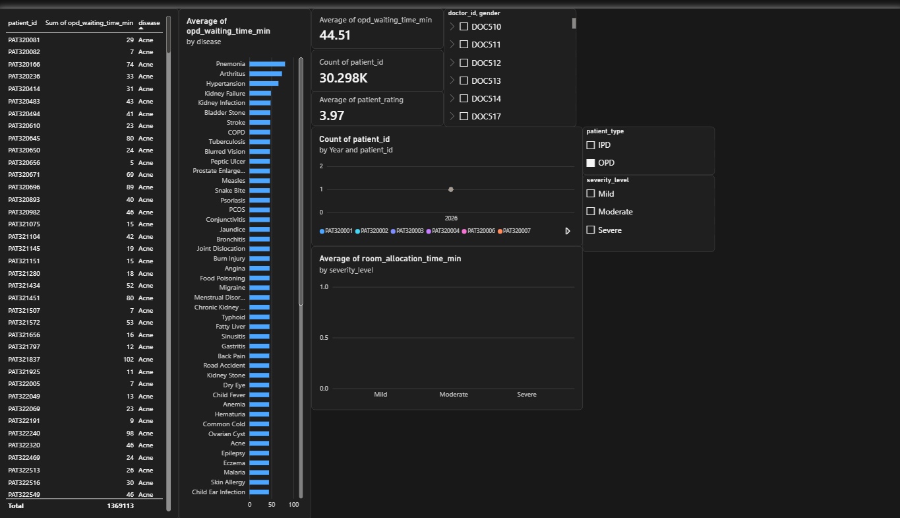

## 5.2 Clinical Pathway & Waiting Time Analysis

### Key Performance Findings
- **Triage to Admission Delay:** Identified as the primary bottleneck, averaging the highest wait time.
- **Resource Constraints:** Peak waiting durations correlate with high emergency intake hours.
- **Pathway Variations:** Non-standard pathways resulted in a 30% higher overall turnaround time.

### Dashboard Visualizations

#### Executive Overview

#### Waiting Time Analysis

